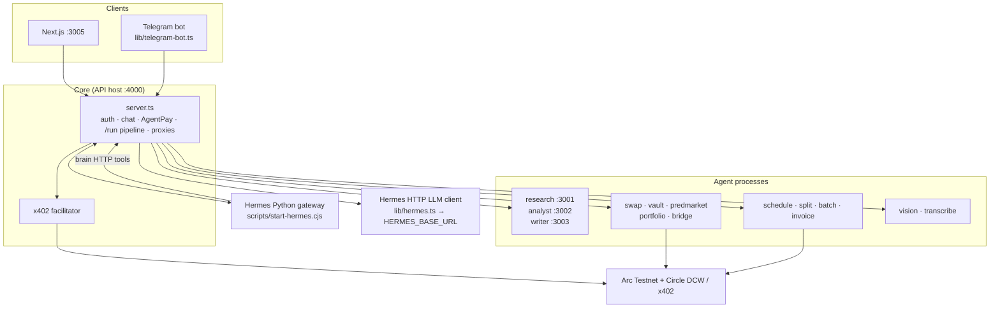
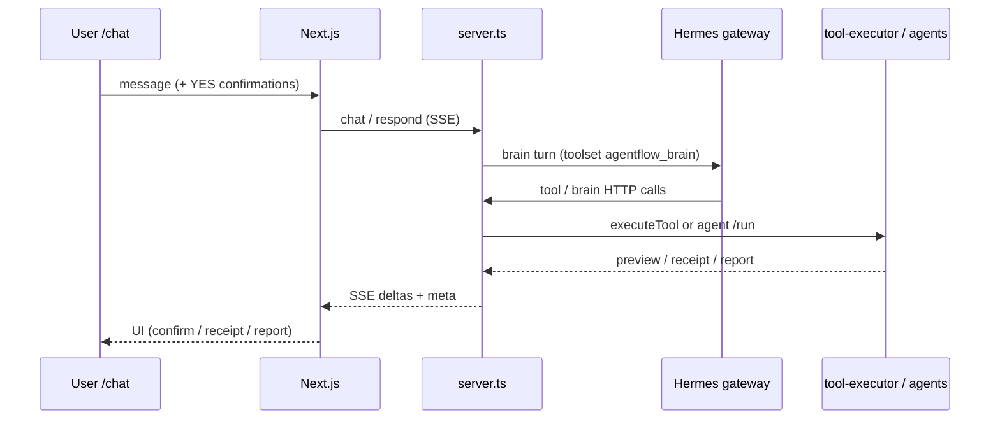
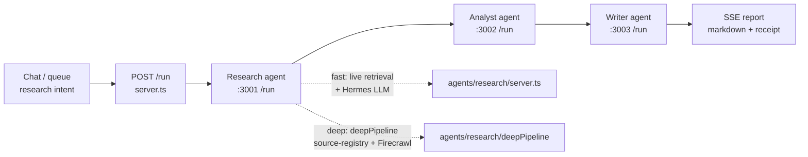

# AgentFlow

Private monorepo for the live **AgentFlow** product on **Arc Testnet**: Circle **x402** micropayments, chat-driven agents, AgentPay, and a Next.js UI.

| | |
|--|--|
| **Private remote** | `pvt` → https://github.com/Snehal707/agentflow-pvt |
| **Production** | PM2 via [`ecosystem.config.cjs`](ecosystem.config.cjs) |
| **Local full stack** | `npm run dev:stack` (`scripts/start-dev-stack.cjs`) |

Backend (`server.ts`, `agents/`, `facilitator/`) and frontend (`agentflow-frontend/`) ship together.

---

## Product surfaces

Nav: `agentflow-frontend/lib/appData.ts`.

| Route | Role |
|-------|------|
| `/chat` | Primary UX — wallet JWT chat; money actions confirm with YES (UI label `Yes, swap & send` when a swap includes a recipient — `ChatThread.tsx`) |
| `/pay` | AgentPay hub (`.arc` handles, send/request, contacts, schedule/split/batch, invoices, history) |
| `/pay/[handle]` | Public pay page |
| `/funding` | Circle Gateway funding + move to **execution (DCW)** wallet (`/vault` re-exports this page) |
| `/portfolio` | Holdings / portfolio UI |
| `/agents` | Agent Store (`lib/coreAgentSpecs.ts`) |
| `/telegram` | Link wallet to Telegram bot |
| `/docs` | Product docs (+ `GET /api/docs`) |
| `/` | Marketing landing → `/chat` |

**Wallets (funding UI):** EOA via WalletConnect for auth; **Gateway** for USDC funding; **execution wallet (DCW)** for agent spend (`GatewayWalletPanel`).

---

## Architecture



**Local vs prod:** `dev:stack` runs facilitator + research/analyst/writer as **separate** processes (`EMBEDDED_AGENT_SERVERS=false`). PM2 `agentflow-backend` runs `server.ts` and **embeds** facilitator + research/analyst/writer. Cron (`crons/index.ts`) is **PM2-only**.

---

## Chat → tools flow



Money paths typically preview first (`confirmed=false` / pending action), then execute after user **YES**.

---

## Research reports pipeline

Chat research is driven through `POST /run` on the public API (`server.ts`), which runs **research → analyst → writer** over x402-protected agent `/run` endpoints (`RESEARCH_URL` / `ANALYST_URL` / `WRITER_URL`). Mode selection: `lib/researchMode.ts` (`fast` default; `deep` when explicit or phrase-matched).



Status copy in `server.ts` for the consumer path:

- **fast:** research → analyst → writer with Firecrawl + SearXNG live retrieval  
- **deep:** source-registry retrieval, Firecrawl verification, analyst review, writer synthesis  

Overflow jobs can enqueue via `lib/research-queue.ts` (Redis). Persist/search helpers: `lib/research-memory.ts`.

---

## Tools

### Schemas executed by `lib/tool-executor.ts`

Source of truth: `lib/agentflow-tools.ts` (`AGENTFLOW_TOOLS`).

| Tool name | Purpose (from schema description) |
|-----------|-----------------------------------|
| `get_balance` | USDC, EURC, and vault balance |
| `swap_tokens` | USDC ↔ EURC; `confirmed=false` preview, `true` after YES |
| `vault_action` | `list` / `position` / `deposit` / `withdraw`; vault symbols `luneUSDC`, `luneEURC` |
| `predict_action` | Pred-market `list` / `detail` / `position` / `buy` / `sell` / `redeem` / `refund` |
| `agentpay_send` | AgentPay send preview → YES before execute |
| `agentpay_request` | Create a payment request (no immediate on-chain send) |
| `bridge_precheck` | Read-only supported CCTP source chains + bridge flow explanation |
| `get_portfolio` | Holdings / PnL analysis |
| `research` | Topic research; `mode`: `fast` \| `deep` |

### Brain HTTP endpoints (Hermes → API)

Mounted on `server.ts` (internal key):

| Method | Path |
|--------|------|
| GET | `/api/brain/balance` |
| GET | `/api/brain/portfolio` |
| GET | `/api/brain/circle-stack` |
| GET | `/api/brain/agentpay-history` |
| POST | `/api/brain/swap` |
| POST | `/api/brain/vault` |
| POST | `/api/brain/bridge` |
| POST | `/api/brain/bridge-precheck` |

Hermes progress UI may show aliased names (e.g. `agentflow_swap`, `agentflow_vault`) that map to the same product clusters in `lib/agent-brain.ts`. Do not treat those strings as a second public API.

Schedule / split / batch / invoice also exist as **Agent Store agents** and `/pay` surfaces; they are not all listed in `AGENTFLOW_TOOLS` above.

---

## Skills

| Path | What it is |
|------|------------|
| [`hermes-skills/agentflow-report-research/SKILL.md`](hermes-skills/agentflow-report-research/SKILL.md) | Report-research skill: retrieval plans `direct` / `light` / `standard`, subquery rules, coverage check, writer handoff brief. In-repo skill pack (not loaded by Node boot). |
| [`agentflow-frontend/SKILL.md`](agentflow-frontend/SKILL.md) | Intent / anti-hallucination skill for payment & balance commands (live-state-only rules; maps phrases to scheduled-payment / balance / history tools). |

Gateway runtime config and soul live under gitignored `hermes-brain/` (`scripts/start-hermes.cjs` → `config.yaml`, `SOUL.md`).

---

## DeFi providers (code)

| Area | Implementation |
|------|----------------|
| **Swap** | `lib/dex/router.ts` quotes **`swaparc`**, **`achswap`**, **`lunex`**, then selects a route |
| **Vault** | `lib/vault/router.ts` — **Lunex only** (`luneUSDC`, `luneEURC`) |
| **Pred markets** | `lib/predmarket/router.ts` — **AchMarket only** |
| **Bridge** | CCTP into Arc; sources in `lib/bridge/supportedSources.ts` |
| **AgentPay** | USDC + EURC — `lib/agentpay-transfer.ts` |

---

## Agent Store

`lib/coreAgentSpecs.ts`:

| Slug | Name |
|------|------|
| `research` | Research (pipeline Research → Analyst → Writer) |
| `swap` | Swap |
| `vault` | Vault (Lunex; testnet / experimental per spec text) |
| `predmarket` | Prediction Markets (AchMarket; testnet / experimental) |
| `bridge` | Bridge |
| `portfolio` | Portfolio |
| `invoice` | Invoice |
| `schedule` / `split` / `batch` | Recurring / split / CSV batch USDC |
| `vision` / `transcribe` | Image-PDF brief / voice → text |

Prices: `*_AGENT_PRICE` env keys in that file.

---

## Runbook

### Prerequisites

- Node **20+**, npm **8+**, `CLOUDSMITH_TOKEN` ([.npmrc](.npmrc))
- Root `.env` from [.env.example](.env.example); `npm run setup`
- `agentflow-frontend/.env.local` from `.env.local.example` (`NEXT_PUBLIC_BACKEND_URL`, `NEXT_PUBLIC_WALLETCONNECT_PROJECT_ID`; optional Telegram username; `OPENAI_API_KEY` for transcribe)
- Local Hermes: `hermes-brain/` checkout + venv

### Local

```bash
npm run dev:stack
```

Starts frontend `:3005`, Hermes, facilitator, research/analyst/writer, API `:4000`, DeFi/payment/media agents, Telegram bot. **No cron.**

| Check | URL |
|-------|-----|
| API | `http://localhost:4000/health` |
| Stack | `http://localhost:4000/health/stack` |
| Frontend | `http://localhost:3005/api/health` |
| Hermes | `/health` on `AGENTFLOW_HERMES_PORT` (default 8000) |

Windows port conflict on 8000 (documented in `.env.example`):

```env
AGENTFLOW_HERMES_PORT=8001
AGENTFLOW_HERMES_URL=http://127.0.0.1:8001
```

Helpers: `npm run stack:detach`, `npm run dev:stack:clean`, `node scripts/stack-cleanup.cjs`. Prefer `FACILITATOR_PORT=3010`.

### Production (PM2)

```bash
npm install
npm run build --prefix agentflow-frontend
pm2 start ecosystem.config.cjs   # first time
pm2 reload all                   # after deploy
pm2 save && pm2 startup
```

PM2 apps: hermes, backend (API + embedded facilitator/R/A/W), swap, vault, portfolio, vision, transcribe, bridge, invoice, split, batch, schedule, predmarket, cron, telegram-bot, frontend (`next start -p 3005`).

### Default ports

| Service | Port |
|---------|------|
| Frontend | 3005 |
| API | 4000 |
| Hermes | 8000 (`AGENTFLOW_HERMES_PORT`) |
| Facilitator | 3010 (`FACILITATOR_PORT`) |
| Research / Analyst / Writer | 3001 / 3002 / 3003 |
| Swap / Vault / Predmarket / Portfolio | 3011 / 3012 / 3013 / 3014 |
| Invoice / Vision / Transcribe | 3015 / 3016 / 3017 |
| Schedule / Split / Batch / Bridge | 3018 / 3019 / 3020 / 3021 |

### Environment

Use [.env.example](.env.example) and `agentflow-frontend/.env.local.example` — do not treat this README as a full env catalog.

Typically required for a working stack: Cloudsmith, Hermes API + gateway, Circle DCW, JWT, Redis/Supabase, facilitator/agent ports, Telegram, WalletConnect, research retrieval keys as needed, `MAINNET_KILL_SWITCH` for money safety.

- [docs/db-access-security.md](docs/db-access-security.md)  
- [docs/known-issues.md](docs/known-issues.md)

---

## Hermes clients

1. **Python gateway** — `scripts/start-hermes.cjs` / PM2 `agentflow-hermes` (chat brain).  
2. **HTTP LLM client** — `lib/hermes.ts` (`OpenAI` SDK against `HERMES_BASE_URL` / `HERMES_API_KEY`; default host `inference-api.nousresearch.com`). Used by research and other direct model calls — separate from the gateway process.

---

## Repo layout

```text
server.ts                 Public API + (prod) embedded facilitator/research/analyst/writer
agentflow-frontend/       Next.js UI (+ SKILL.md intent guidance)
agents/                   Microservices (/run handlers)
facilitator/              x402 facilitator
api/                      Express routers
lib/                      Brain, tools, dex/vault/predmarket, AgentPay, research queue, …
hermes-skills/            In-repo Hermes skill pack (report research)
crons/                    Production schedulers (PM2)
scripts/                  Stack / Hermes launchers
ecosystem.config.cjs      PM2 apps
docs/                     Ops notes
contracts/ · foundry/     On-chain tooling
```

Gitignored runtime/local: `hermes-brain/`, `tmp/`, `.logs/`, `.agentflow-telemetry/` (see `.gitignore`).

---

## Arc Testnet

Chain ID `5042002` · RPC `https://rpc.testnet.arc.network` · Explorer https://testnet.arcscan.app · USDC as gas

---

## Out of scope

Not the live product path: `/dashboard`, `orchestrator/` / `npm run dev:orchestrator`, Railway writeups, one-off probe scripts. Prefer this README + the cited source files + `ecosystem.config.cjs`.
