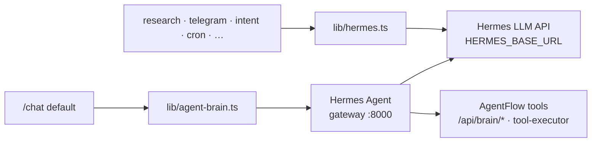
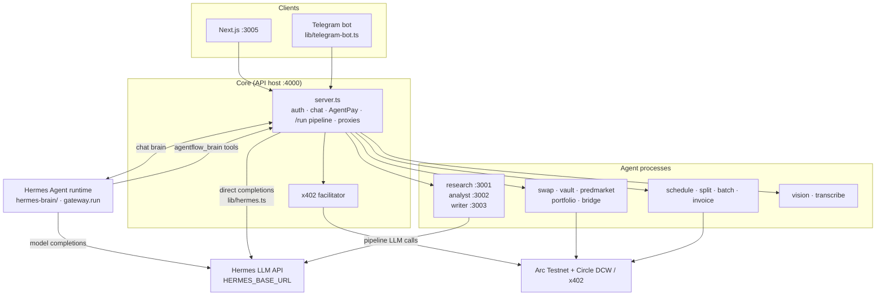
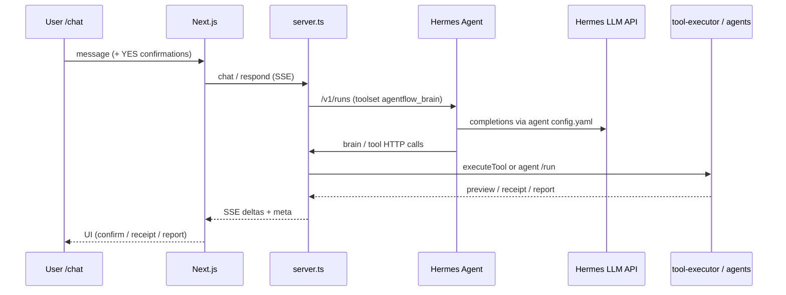

# AgentFlow

Private monorepo for the live **AgentFlow** product on **Arc Testnet**: Circle **x402** micropayments, chat-driven agents, AgentPay, and a Next.js UI.

| | |
|--|--|
| **Private remote** | `pvt` → https://github.com/Snehal707/agentflow-pvt |
| **Production** | PM2 via [`ecosystem.config.cjs`](ecosystem.config.cjs) |
| **Local full stack** | `npm run dev:stack` (`scripts/start-dev-stack.cjs`) |

Backend (`server.ts`, `agents/`, `facilitator/`) and frontend (`agentflow-frontend/`) ship together.

---

## Product surfaces

App nav (`agentflow-frontend/lib/appData.ts`): `/chat`, `/pay`, `/funding`, `/portfolio`, `/agents`, `/telegram`.

App shell (`app/(app)/layout.tsx`) wraps those routes with **`AccessCodeGate`** (access code) in addition to wallet JWT auth.

| Route | Role |
|-------|------|
| `/chat` | Primary UX — wallet JWT chat; money actions confirm with YES (UI label `Yes, swap & send` when a swap includes a recipient — `ChatThread.tsx`) |
| `/pay` | AgentPay hub (`.arc` handles, send/request, contacts, schedule/split/batch, invoices, history) |
| `/pay/[handle]` | Public pay page |
| `/funding` | Circle Gateway funding + move to **execution (DCW)** wallet (`/vault` re-exports this page; UI in `funding/page.tsx`) |
| `/portfolio` | Holdings / portfolio UI |
| `/agents` | Agent Store (`lib/coreAgentSpecs.ts`) — prices + reputation |
| `/telegram` | Link wallet to Telegram bot |
| `/docs` | Marketing docs (+ `GET /api/docs`) — marketing nav, not app sidebar |
| `/` | Marketing landing → `/chat` |
| `/internal/*` | Ops-only (`memory`, `review`, `feedback`) — `INTERNAL_PANEL_KEY` + `INTERNAL_ADMIN_WALLETS` |

**Auth (product path):** WalletConnect → nonce/sign JWT (`api/auth.ts`) → access-code claim (`api/access.ts`). Sign domain / TTL: `AUTH_SIGN_DOMAIN`, `AUTH_NONCE_TTL_SECONDS`.

**Wallets:** connected EOA for auth; Circle **Gateway** for USDC funding; per-user **execution wallet (DCW, `user_agent`)** for agent spend (`api/wallet.ts`, `lib/dcw.ts`). Spend policies / kill switch: `lib/execution-guard.ts` (`MAINNET_KILL_SWITCH` blocks money paths when set).

---

## Hermes Agent vs Hermes LLM (same brand, different layers)

Easy to conflate — both say “Hermes.” In this repo they are **not** two peer clients:

| | **Hermes Agent** | **Hermes LLM** |
|--|------------------|----------------|
| **What** | Agent **runtime** ([NousResearch/hermes-agent](https://github.com/nousresearch/hermes-agent)): sessions, tool loop, API server | **Model / inference API** (e.g. Hermes-4-70B / 405B) |
| **Where here** | `hermes-brain/` · `python -m gateway.run` via `scripts/start-hermes.cjs` · PM2 `agentflow-hermes` · port `AGENTFLOW_HERMES_PORT` (default 8000) | `HERMES_BASE_URL` (default `https://inference-api.nousresearch.com/v1`) |
| **AgentFlow entry** | `lib/agent-brain.ts` → `AGENTFLOW_HERMES_URL` (`/v1/runs`, `/events`, `/health`) | (1) Agent `config.yaml` model provider; (2) Node `lib/hermes.ts` (`callHermesFast` / `callHermesDeep`) |
| **Env** | `AGENTFLOW_HERMES_PORT` / `AGENTFLOW_HERMES_URL`, API server key | `HERMES_API_KEY`, `HERMES_BASE_URL`, `HERMES_MODEL*` |

**Relationship:** Hermes Agent **uses** the Hermes LLM (configured in `hermes-brain/config.yaml` by `start-hermes.cjs`). Chat goes Agent → LLM. Many other paths call the **same LLM API directly** via `lib/hermes.ts` and never open an Agent `/v1/runs` session.



### When each is used (from call sites)

#### Hermes Agent (`AGENTFLOW_HERMES_URL` → `/v1/runs`)

| When | Code |
|------|------|
| **Default web `/chat` conversation** (tool-using brain turn) | `server.ts` → `runAgentBrain()` in `lib/agent-brain.ts` |
| **Fast-report quality review** (optional gate on writer draft; needs `AGENTFLOW_HERMES_URL` set) | `lib/fast-report-supervisor.ts` → local `/v1/runs` with toolset `clarify`; rewrite step then uses plain LLM |
| QA scripts that exercise chat brain | `scripts/test-hermes-chat-*.ts`, etc. |

Chat path does **not** call `lib/hermes.ts` for the main turn — the Agent process calls the LLM using its own `config.yaml`.

#### Plain Hermes LLM (`lib/hermes.ts` → `HERMES_BASE_URL`)

| When | Code |
|------|------|
| **Research agent** (fast path synthesis) | `agents/research/server.ts` → `callHermesFast` |
| **Research helpers** (orchestrate / claims / verify / synthesize) | `agents/research/{orchestrator,claimExtractor,verifier,synthesizer}.ts` |
| **Analyst / Writer agents** | `agents/analyst/server.ts`, `agents/writer/server.ts` → `callHermesFast` |
| **Embedded R/A/W inside `server.ts`** (same prompts when those apps are in-process) | `server.ts` → `callHermesFast` for research/analyst/writer handlers |
| **Post-report chat follow-up** (after a report exists; not a full brain tool turn) | `server.ts` → `callHermesFast(REPORT_FOLLOWUP_…)` |
| **Profile-fact extraction** from chat messages | `server.ts` → `callHermesFast` |
| **Report language translate** | `lib/reportTranslate.ts` |
| **Telegram free-form chat answers** | `lib/telegram-bot.ts` → `callHermesFast` (Telegram does **not** use `runAgentBrain`) |
| **Telegram intent parsing** | `lib/telegram-intent-parser.ts` |
| **Schedule agent NL intent** | `agents/schedule/schedule-agent.ts` |
| **Portfolio narrative** | `agents/portfolio/portfolio.ts` → `callHermesDeep` |
| **Invoice PDF parse** | `agents/invoice/subagents/pdf-parser.ts` → `callHermesDeep` |
| **Vision/text/PDF assist** (Hermes-first; OpenAI fallback for some attachments; audio uses OpenAI) | `lib/mediaAgentUtils.ts` |
| **Market understanding** | `lib/market-understanding.ts` |
| **Daily report cron** | `lib/daily-report.ts` ← `crons/index.ts` |
| **Intent router** (when `INTENT_ROUTER_ENABLED=true`; default **false** in `.env.example`) | `lib/intent-router/index.ts` → `hermes.chat.completions.create` |
| Fast-report **rewrite** after Agent review | `lib/fast-report-supervisor.ts` → `callHermesFast` |

#### Both in one flow (example)

Fast report supervisor (`lib/fast-report-supervisor.ts`, used from writer / `server.ts`):

1. **Review** → Hermes Agent `/v1/runs` (if `AGENTFLOW_HERMES_URL` is set and supervisor enabled)  
2. **Rewrite** (if needed) → plain `callHermesFast`

If Agent URL is unset, supervisor skips and keeps the draft (no Agent call).

---


## Architecture



**Local vs prod:** `dev:stack` runs facilitator + research/analyst/writer as **separate** processes (`EMBEDDED_AGENT_SERVERS=false`). PM2 `agentflow-backend` runs `server.ts` and **embeds** facilitator + research/analyst/writer. Cron (`crons/index.ts`) is **PM2-only**.

---

## Chat → tools flow



Money paths typically preview first (`confirmed=false` / pending action), then execute after user **YES**.

---

## Research reports pipeline

Chat research is driven through `POST /run` on the public API (`server.ts`), which runs **research → analyst → writer** over x402-protected agent `/run` endpoints (`RESEARCH_URL` / `ANALYST_URL` / `WRITER_URL`). Mode selection: `lib/researchMode.ts` (`fast` default; `deep` when explicit or phrase-matched).


Status copy in `server.ts` for the consumer path:

- **fast:** research → analyst → writer with Firecrawl + SearXNG live retrieval  
- **deep:** source-registry retrieval, Firecrawl verification, analyst review, writer synthesis  

Overflow jobs can enqueue via `lib/research-queue.ts` (Redis). Persist/search helpers: `lib/research-memory.ts`.

---

## Tools

### Schemas executed by `lib/tool-executor.ts`

Source of truth: `lib/agentflow-tools.ts` (`AGENTFLOW_TOOLS`).

| Tool name | Purpose (from schema description) |
|-----------|-----------------------------------|
| `get_balance` | USDC, EURC, and vault balance |
| `swap_tokens` | USDC ↔ EURC; `confirmed=false` preview, `true` after YES |
| `vault_action` | `list` / `position` / `deposit` / `withdraw`; vault symbols `luneUSDC`, `luneEURC` |
| `predict_action` | Pred-market `list` / `detail` / `position` / `buy` / `sell` / `redeem` / `refund` |
| `agentpay_send` | AgentPay send preview → YES before execute |
| `agentpay_request` | Create a payment request (no immediate on-chain send) |
| `bridge_precheck` | Read-only supported CCTP source chains + bridge flow explanation |
| `get_portfolio` | Holdings / PnL analysis |
| `research` | Topic research; `mode`: `fast` \| `deep` |

### Brain HTTP endpoints (Hermes Agent → API)

Mounted on `server.ts` (internal key):

| Method | Path |
|--------|------|
| GET | `/api/brain/balance` |
| GET | `/api/brain/portfolio` |
| GET | `/api/brain/circle-stack` |
| GET | `/api/brain/agentpay-history` |
| POST | `/api/brain/swap` |
| POST | `/api/brain/vault` |
| POST | `/api/brain/bridge` |
| POST | `/api/brain/bridge-precheck` |

Hermes Agent progress UI may show aliased names (e.g. `agentflow_swap`, `agentflow_vault`) that map to the same product clusters in `lib/agent-brain.ts`. Do not treat those strings as a second public API.

Schedule / split / batch / invoice also exist as **Agent Store agents** and `/pay` surfaces; they are not all listed in `AGENTFLOW_TOOLS` above.

---

## Skills

| Path | What it is |
|------|------------|
| [`hermes-skills/agentflow-report-research/SKILL.md`](hermes-skills/agentflow-report-research/SKILL.md) | Report-research skill: retrieval plans `direct` / `light` / `standard`, subquery rules, coverage check, writer handoff brief. In-repo skill pack (not loaded by Node boot). |
| [`agentflow-frontend/SKILL.md`](agentflow-frontend/SKILL.md) | Intent / anti-hallucination skill for payment & balance commands (live-state-only rules; maps phrases to scheduled-payment / balance / history tools). |

Hermes Agent config + soul: gitignored `hermes-brain/` (`scripts/start-hermes.cjs` writes `config.yaml`, `SOUL.md`).

---

## Reputation, ratings & agent economy

Not in the nav as their own page; wired into Agent Store + paid-task flows.

| Piece | Where |
|-------|--------|
| **On-chain reputation** (ERC-8004 Reputation Registry) | `lib/reputation.ts` · registry address `ARC.reputationRegistry` in `lib/arc-config.ts` |
| **User star ratings** (web chat, post paid task) | `POST /api/agent-ratings` → `api/agent-ratings.ts` → `submitReputationFeedback` (stars × 20 = score); FE proxy `agentflow-frontend/app/api/agent-ratings/route.ts` |
| **Ratings DB** | `db/migrations/20260515_create_agent_ratings.sql` (`agent_ratings`) |
| **Agent Store UI** | `/agents` — `agentflow-frontend/app/(app)/agents/page.tsx` shows `reputationScore` / rating stats |
| **Product copy** | `agentflow-frontend/lib/docsContent.ts` + `lib/product-rag.ts` (`reputation` topic) |
| **A2A payment ledger** (agent→agent x402 settlements) | `lib/a2a-ledger.ts` → `lib/agent-economy-ledger.ts` · `GET /api/agent-economy-ledger` · migration `db/migrations/20260504_create_agent_economy_ledger.sql` |
| **A2A follow-ups** (e.g. invoice→research, portfolio after tool) | `lib/a2a-chat-scheduler.ts`, `lib/a2a-followups.ts` (used from `server.ts`) |
| **Identity / validation registries** | `ARC.identityRegistry`, `ARC.validationRegistry` in `lib/arc-config.ts` (identity minting is live via `lib/mintIdentityOwners.ts`; validation address is configured — little/no other runtime use in `lib/`) |
| **AgentPay `.arc` registry (on-chain)** | `contracts/AgentPayRegistry.sol`, `lib/agentpay-registry.ts`, `AGENTPAY_REGISTRY_ADDRESS` — register/resolve via `api/pay.ts` |
| **x402 attempt ledger** | `lib/x402AttemptLedger.ts` (payment attempts, not reputation) |

Some agents also call `recordReputationSafe` after runs (e.g. `agents/vision/server.ts`, `agents/transcribe/server.ts`).

**Counterparty / handle “reputation” in chat** is separate: research can use an internal reputation **cache** + payment history for `.arc` risk questions (`server.ts` / capability routing) — not the same as ERC-8004 agent ratings.

---

## DeFi providers (code)

| Area | Implementation |
|------|----------------|
| **Swap** | `lib/dex/router.ts` quotes **`swaparc`**, **`achswap`**, **`lunex`**, then selects a route |
| **Vault** | `lib/vault/router.ts` — **Lunex only** (`luneUSDC`, `luneEURC`) |
| **Pred markets** | `lib/predmarket/router.ts` — **AchMarket only** |
| **Bridge** | CCTP into Arc; sources in `lib/bridge/supportedSources.ts` |
| **AgentPay** | USDC + EURC — `lib/agentpay-transfer.ts` |

### x402 facilitator

Circle **Gateway batched** payments proxy (`facilitator/server.ts` — `/v1/x402/supported|verify|settle`). Local `dev:stack` runs it as its own process; **PM2 embeds it inside `agentflow-backend`** (`EMBEDDED_AGENT_SERVERS` default true in prod). Prefer `FACILITATOR_PORT=3010` in `.env` (code falls back to 3000 if unset).

---

## Agent Store

`lib/coreAgentSpecs.ts`:

| Slug | Name |
|------|------|
| `research` | Research (pipeline Research → Analyst → Writer) |
| `swap` | Swap |
| `vault` | Vault (Lunex; testnet / experimental per spec text) |
| `predmarket` | Prediction Markets (AchMarket; testnet / experimental) |
| `bridge` | Bridge |
| `portfolio` | Portfolio |
| `invoice` | Invoice |
| `schedule` / `split` / `batch` | Recurring / split / CSV batch USDC |
| `vision` / `transcribe` | Vision: x402-paid image/PDF brief (Hermes + OpenAI fallback). Transcribe: voice → text via OpenAI; **$0** fallback price, JWT + daily caps (no x402 middleware on agent) |

Prices: `*_AGENT_PRICE` env keys in that file.

---

## Production cron (`crons/index.ts`)

Runs only when `NODE_ENV=production` (PM2 `agentflow-cron`). From that file:

| Job | Schedule (UTC) |
|-----|----------------|
| Yield monitor | every 6h |
| Semantic-memory consolidation | every 6h at :15 |
| Agent treasury top-up | hourly |
| Daily reports (topics) + due scheduled USDC payments | 09:00 |
| Weekly `arc_ecosystem` report | Monday 09:00 |
| Training export | 03:00 daily |
| Monthly business digest | 1st of month 09:00 |

Semantic memory capture/retrieval also feeds chat context (`lib/semantic-memory.ts`); local/telemetry dirs are gitignored (`.agentflow-memory/`, `.agentflow-telemetry/`).

---

## Runbook

### Prerequisites

- Node **20+**, npm **8+**, `CLOUDSMITH_TOKEN` ([.npmrc](.npmrc))
- Root `.env` from [.env.example](.env.example); `npm run setup`
- `agentflow-frontend/.env.local` from `.env.local.example` (`NEXT_PUBLIC_BACKEND_URL`, `NEXT_PUBLIC_WALLETCONNECT_PROJECT_ID`; optional Telegram username; `OPENAI_API_KEY` for transcribe)
- Local Hermes Agent: `hermes-brain/` checkout + venv (model via `HERMES_*`)

### Local

```bash
npm run dev:stack
```

Starts frontend `:3005`, Hermes Agent, facilitator, research/analyst/writer, API `:4000`, DeFi/payment/media agents, Telegram bot. **No cron.**

| Check | URL |
|-------|-----|
| API | `http://localhost:4000/health` |
| Stack | `http://localhost:4000/health/stack` |
| Frontend | `http://localhost:3005/api/health` |
| Hermes Agent | `/health` on `AGENTFLOW_HERMES_PORT` (default 8000) |

**`/health/stack` scope** (`server.ts`): probes **facilitator, research, analyst, writer, bridge, vision, transcribe** only. It does **not** include swap, vault, predmarket, portfolio, invoice, schedule, split, or batch — those can be up while `ok` is still true if the listed subset is healthy. Hit each agent’s own `/health` (ports above) when debugging DeFi/payment agents.

Windows port conflict on 8000 (documented in `.env.example`):

```env
AGENTFLOW_HERMES_PORT=8001
AGENTFLOW_HERMES_URL=http://127.0.0.1:8001
```

Helpers: `npm run stack:detach`, `npm run dev:stack:clean`, `node scripts/stack-cleanup.cjs`. Prefer `FACILITATOR_PORT=3010`.

### Production (PM2)

```bash
npm install
npm run build --prefix agentflow-frontend
pm2 start ecosystem.config.cjs   # first time
pm2 reload all                   # after deploy
pm2 save && pm2 startup
```

PM2 apps: hermes (Agent), backend (API + embedded facilitator/R/A/W), swap, vault, portfolio, vision, transcribe, bridge, invoice, split, batch, schedule, predmarket, cron, telegram-bot, frontend (`next start -p 3005`).

### Default ports

| Service | Port |
|---------|------|
| Frontend | 3005 |
| API | 4000 |
| Hermes Agent | 8000 (`AGENTFLOW_HERMES_PORT`) |
| Facilitator | Prefer **3010** via `FACILITATOR_PORT` (unset → code default **3000**) |
| Research / Analyst / Writer | 3001 / 3002 / 3003 |
| Swap / Vault / Predmarket / Portfolio | 3011 / 3012 / 3013 / 3014 |
| Invoice / Vision / Transcribe | 3015 / 3016 / 3017 |
| Schedule / Split / Batch / Bridge | 3018 / 3019 / 3020 / 3021 |

### Environment

Use [.env.example](.env.example) and `agentflow-frontend/.env.local.example` — do not treat this README as a full env catalog.

Typically needed: Cloudsmith, Hermes LLM (`HERMES_*`), Hermes Agent port/URL + brain internal key, Circle DCW, JWT + auth domain, Redis/Supabase, facilitator/agent ports, Telegram, WalletConnect, `AGENTPAY_REGISTRY_ADDRESS`, research retrieval keys as needed.

Safety (optional / policy): `MAINNET_KILL_SWITCH` (blocks money execution when set — `lib/execution-guard.ts`), pay-per-task and vision/transcribe daily limits (`.env.example`).

### Debug / telemetry flags (`.env.example`)

Optional; leave unset unless debugging:

| Flag | Role |
|------|------|
| `AGENTFLOW_X402_DEBUG` | x402 path logging |
| `AGENTFLOW_CIRCLE_DEBUG` | Circle/DCW logging |
| `AGENTFLOW_A2A_DEBUG` | A2A follow-up logging |
| `AGENTFLOW_CHAT_SESSION_TRACE` | Chat session tracing |
| `AGENTFLOW_CHAT_SSE_DEBUG` | Chat SSE debug events |
| `FAST_REPORT_SUPERVISOR_ENABLED` | Fast-report Agent review gate (default on if Agent URL set) |
| `INTENT_ROUTER_ENABLED` | Alternate intent router (default **false**) |

Local dirs (gitignored): `.agentflow-telemetry/`, `.logs/`, `.agentflow-memory/`.

### Operator npm scripts

Useful ops scripts from root `package.json` (not the full test catalog):

| Script | Purpose |
|--------|---------|
| `npm run setup` | First-time install (Cloudsmith token) |
| `npm run dev:stack` / `dev:stack:clean` / `stack:detach` | Full local stack |
| `npm run dev:hermes` / `dev:chat-core` | Hermes only / minimal chat core |
| `npm run start:api` | API only (`EMBEDDED_AGENT_SERVERS=false`) |
| `npm run qa:prelaunch` / `qa:chat-prelaunch` / `qa:agents-prelaunch` | Pre-launch QA |
| `npm run cron:worker` | Cron entry (exits unless `NODE_ENV=production`) |
| `npm run treasury:topup` | One-shot agent treasury top-up |
| `npm run memory:consolidate` / `memory:metrics` / `memory:eval` | Semantic memory jobs |
| `npm run script:pre-launch` / `script:check-balances` | Pre-launch / balance checks |
| `npm run script:setup-circle` / `script:mint-identity` / `script:create-missing-wallets` | Circle / ERC-8004 identity bootstrap |
| `npm run deposit:agent-gateway` / `fund:agent-wallets` | Fund agent Gateway / wallets |
| `npm run contract:deploy-agentpay-registry` | Deploy AgentPay `.arc` registry (Hardhat) |
| `npm run typecheck` | `tsc --noEmit` |

Individual agents: `npm run dev:swap`, `dev:vault`, `dev:bridge`, … (see `package.json`).

### API mounts (`server.ts`)

Product-relevant mounts on the public API (not every handler):

| Mount / route | Role |
|---------------|------|
| `/api/auth` | Wallet nonce + JWT |
| `/api/access` | Access-code claim / status |
| `/api/wallet` | Gateway + execution wallet |
| `/api/telegram` | Telegram link state |
| `/api/settings` | User settings |
| `/api/agentpay`, `/api/business` | Business / AgentPay onboarding (shared router) |
| `/api/pay` | Send, schedule, `.arc` registry, contacts, history |
| `/api/agent-store` | Agent catalog |
| `/api/agent-ratings` | Post-task star ratings → ERC-8004 |
| `/api/agent-economy-ledger` | A2A / economy ledger |
| `/api/portfolio` | Portfolio API |
| `/api/docs`, `/api/stats` | Docs topics / stats |
| `/api/chat/respond`, `/api/chat/feedback` | Chat SSE + feedback |
| `/api/research/status/:jobId`, `/api/research/queue` | Research job status |
| `/api/x402/preflight`, `/api/x402/attempts/*` | x402 preflight + attempt ledger |
| `/api/brain/*` | Hermes Agent brain tools |
| `/api/schedule|split|batch|invoice/*` | Payment agent confirm/run proxies |
| `/api/bridge/finalize` | Bridge finalize |
| `/api/media/quota` | Vision/transcribe quotas |
| `/api/dcw/agents/:slug/run` | DCW-paid agent run |
| `/api/profile/remember` | Profile facts |
| `/api/memory/*`, `/api/internal/*` | Admin memory / review / feedback |
| `POST /run` | Research → analyst → writer pipeline |
| `/health`, `/health/stack` | Liveness (stack = subset; see above) |

Still mounted but **not product** (retired plan): `/api/extension`, `/api/webhooks/email`.

- [docs/db-access-security.md](docs/db-access-security.md)  
- [docs/known-issues.md](docs/known-issues.md)

---

## Repo layout

```text
server.ts                 Public API + (prod) embedded facilitator/research/analyst/writer
agentflow-frontend/       Next.js UI (+ SKILL.md intent guidance)
agents/                   Microservices (/run handlers)
facilitator/              x402 facilitator
api/                      Express routers
lib/                      Brain, tools, dex/vault/predmarket, AgentPay, research queue, …
hermes-skills/            Skill pack for Hermes Agent (report research)
crons/                    Production schedulers (PM2)
scripts/                  Stack / Hermes Agent launchers
ecosystem.config.cjs      PM2 apps
docs/                     Ops notes
contracts/ · foundry/     On-chain tooling
```

Gitignored runtime/local: `hermes-brain/` (Hermes Agent checkout), `tmp/`, `.logs/`, `.agentflow-telemetry/` (see `.gitignore`).

---

## Arc Testnet

Chain ID `5042002` · RPC `https://rpc.testnet.arc.network` · Explorer https://testnet.arcscan.app · USDC as gas

---

## Out of scope

Not the live product path: `/dashboard`, `orchestrator/` / `npm run dev:orchestrator`, Railway writeups, one-off probe scripts, and retired surfaces such as the browser **extension** API and **email inbound** webhook (code may still exist under `api/extension.ts` / `api/webhooks/email.ts` — not documented as product). Prefer this README + the cited source files + `ecosystem.config.cjs`.
