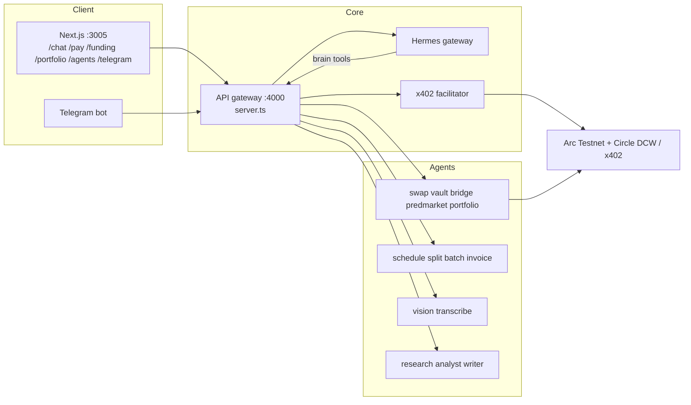

# AgentFlow

Private monorepo for the **live AgentFlow** stack: Arc Testnet AI agent economy with Circle **x402** micropayments, chat-driven DeFi + AgentPay, and a Next.js UI.

Backend (`server.ts` + agents) and frontend (`agentflow-frontend/`) ship together. Production runs on a VPS under **PM2** (`ecosystem.config.cjs`). Private remote: `pvt` → `agentflow-pvt`.

## What it is today

| Surface | Route | What users do |
|---------|-------|----------------|
| **Chat** | `/chat` | Main product — wallet JWT chat for research, DeFi, AgentPay, vision/transcribe; money actions confirm with **YES** |
| **AgentPay** | `/pay` | `.arc` names, send/request (USDC/EURC), contacts, schedule/split/batch, invoices, history |
| **Pay link** | `/pay/[handle]` | Public page to pay a `.arc` handle |
| **Funding** | `/funding` | Fund the Circle **execution (DCW)** wallet for agent-paid actions (`/vault` redirects here) |
| **Portfolio** | `/portfolio` | EOA + execution-wallet holdings, vault shares, Gateway reserve, PnL snapshot |
| **Agents** | `/agents` | Agent Store — browse/run priced x402 agents |
| **Telegram** | `/telegram` | Link wallet → Telegram bot for mobile chat + AgentPay deep links |
| **Docs** | `/docs` | Product docs (live topics from the API) |
| **Landing** | `/` | Marketing site → CTA to `/chat` |

**Wallets:** connect an EOA (WalletConnect) for auth; agents spend from the Circle **DCW execution wallet** (fund via `/funding`). Gateway reserve shows in portfolio.

**Chat can do (current):** research reports · USDC↔EURC swap (incl. **swap & send** to a `.arc` handle) · vault deposit/withdraw (Lunex testnet) · CCTP bridge into Arc · prediction markets (AchMarket testnet) · portfolio · send / schedule / split / batch / invoice · vision + voice transcript.

Stack pieces:

- **API gateway** (`server.ts`, `:4000`) — auth, chat/brain, AgentPay, wallets, x402 attempts, research queue, agent proxies
- **Hermes gateway** (Python, default `:8000`) — chat reasoning; calls brain tools on the API
- **x402 facilitator** — settlement for paid agent calls
- **Agents** — see catalog below
- **Telegram bot** — always-on poller (`lib/telegram-bot.ts`)
- **Cron** (production only) — scheduled payments, treasury top-up, semantic memory, daily reports, yield monitor

## Agent catalog (Agent Store)

| Slug | Role |
|------|------|
| `research` | Research → Analyst → Writer report pipeline |
| `swap` | Quote/execute Arc swaps (USDC/EURC) with guardrails |
| `vault` | Yield vaults (Lunex on testnet) |
| `predmarket` | Prediction markets (AchMarket on testnet) |
| `bridge` | CCTP bridge USDC into Arc (Sepolia / Base / Arb / Fuji / Amoy, …) |
| `portfolio` | Balances, positions, transfers, PnL |
| `invoice` | Business invoice review / settlement |
| `schedule` / `split` / `batch` | Recurring, split, and batch USDC payouts |
| `vision` / `transcribe` | Image/PDF brief · short voice → text |

Specs + prices: `lib/coreAgentSpecs.ts` (overridable via `*_AGENT_PRICE` env).

## Quick start (local)

1. **Prerequisites:** Node **20+**, npm **8+**, `CLOUDSMITH_TOKEN` for `@circlefin/*` (see [.npmrc](.npmrc)). Local Hermes needs a `hermes-brain/` checkout with venv (gitignored; `scripts/start-hermes.cjs` launches it).
2. **Root env:** copy [.env.example](.env.example) → `.env`, then `npm run setup`.
3. **Frontend env:** copy `agentflow-frontend/.env.local.example` → `agentflow-frontend/.env.local`  
   Set `NEXT_PUBLIC_BACKEND_URL=http://localhost:4000`, `NEXT_PUBLIC_WALLETCONNECT_PROJECT_ID`, and optionally `NEXT_PUBLIC_TELEGRAM_BOT_USERNAME`.  
   Transcribe needs `OPENAI_API_KEY` (frontend `.env.local` or root `.env`).
4. **Run the full product stack:**

   ```bash
   npm run dev:stack
   ```

   Starts API **:4000**, Hermes, facilitator, all dedicated agents, Telegram bot, and Next.js on **:3005** (`EMBEDDED_AGENT_SERVERS=false`). **Does not** start `crons/` — that is PM2-only in production.

   **Health:** `http://localhost:4000/health` · `http://localhost:4000/health/stack` · `http://localhost:3005/api/health` · Hermes `/health`

   **Windows:** if `:8000` is stuck (IP Helper), pin Hermes in `.env`:

   ```env
   AGENTFLOW_HERMES_PORT=8001
   AGENTFLOW_HERMES_URL=http://127.0.0.1:8001
   ```

   Use `npm run stack:detach` to keep the supervisor in its own PowerShell window. Clean restart: `npm run dev:stack:clean` or `node scripts/stack-cleanup.cjs`.

5. **Frontend hot reload only:** `npm run dev:frontend:hot`

Prefer **`FACILITATOR_PORT=3010`** so facilitator does not collide with other tools on `:3000`.

## Ports (current defaults)

| Service | Port |
|---------|------|
| Next.js UI | 3005 |
| Public API | 4000 |
| Hermes gateway | 8000 (or `AGENTFLOW_HERMES_PORT`) |
| Facilitator | 3010 |
| Research / Analyst / Writer | 3001 / 3002 / 3003 |
| Swap / Vault / Predmarket / Portfolio | 3011 / 3012 / 3013 / 3014 |
| Invoice / Vision / Transcribe | 3015 / 3016 / 3017 |
| Schedule / Split / Batch / Bridge | 3018 / 3019 / 3020 / 3021 |

## Architecture



**Hermes has two roles today:**

1. **Python gateway** (`scripts/start-hermes.cjs` → local `hermes-brain/`) — default chat brain; skills live under `hermes-skills/`.
2. **Nous / Hermes API client** (`lib/hermes.ts`) — research pipeline and other direct LLM calls (`HERMES_API_KEY`, `HERMES_BASE_URL`, models).

## Repo layout

```text
├── server.ts                 # Public API + (in prod) embedded facilitator/research/analyst/writer
├── agentflow-frontend/       # Next.js 14 product UI
├── agents/                   # Paid + pipeline microservices
├── facilitator/              # x402 facilitator
├── hermes-skills/            # Skills for the Hermes gateway
├── lib/                      # Shared backend (brain, AgentPay, routing, …)
├── api/                      # Express routers mounted by server.ts
├── crons/                    # Production schedulers (PM2 agentflow-cron)
├── scripts/                  # dev:stack, Hermes launcher, QA helpers
├── ecosystem.config.cjs      # VPS PM2 process list
├── docs/                     # Ops notes (db security, known issues, …)
└── contracts/ · foundry/     # On-chain tooling (not the web UX)
```

Gitignored local checkouts/artifacts: `hermes-brain/`, `tmp/`, `.logs/`, `.agentflow-telemetry/`.

## Environment (what matters)

Full list: [.env.example](.env.example) + `agentflow-frontend/.env.local.example`. For the current product:

| Area | Vars |
|------|------|
| Install | `CLOUDSMITH_TOKEN` |
| Data | Supabase + `REDIS_URL` (required at runtime — see your deployed `.env`) |
| Auth | `JWT_SECRET`, `AUTH_SIGN_DOMAIN`, `APP_BASE_URL` |
| Circle DCW | `CIRCLE_API_KEY`, `CIRCLE_ENTITY_SECRET`, optional `CIRCLE_WALLET_SET_ID` |
| Hermes LLM | `HERMES_API_KEY`, `HERMES_BASE_URL`, `HERMES_MODEL*` |
| Hermes gateway | `AGENTFLOW_HERMES_URL` / `AGENTFLOW_HERMES_PORT`, `AGENTFLOW_BRAIN_INTERNAL_KEY` |
| x402 / chain | `SELLER_ADDRESS`, `FACILITATOR_PORT` (and `*_AGENT_PORT` / URLs when split) |
| Safety | `MAINNET_KILL_SWITCH=true` blocks money paths |
| Telegram | `TELEGRAM_BOT_TOKEN`, `TELEGRAM_BOT_USERNAME` (+ matching `NEXT_PUBLIC_*`) |
| Frontend | `NEXT_PUBLIC_BACKEND_URL`, `NEXT_PUBLIC_WALLETCONNECT_PROJECT_ID` |
| Media / memory | `OPENAI_API_KEY` (transcribe + embeddings) |
| Research | Firecrawl / optional `SEARXNG_API_URL` + source API keys as needed |

Ops-only (not product UX): `INTERNAL_ADMIN_WALLETS`, `INTERNAL_PANEL_KEY` → `/internal/*` panels.

See [docs/db-access-security.md](docs/db-access-security.md) for Supabase RLS notes.

## Production (VPS + PM2)

Canonical deploy is **this repo on the VPS** with [`ecosystem.config.cjs`](ecosystem.config.cjs):

```bash
git pull   # from private remote / deploy path, e.g. /opt/agentflow
npm install
npm run build --prefix agentflow-frontend
pm2 start ecosystem.config.cjs   # first time
pm2 reload all                   # after a deploy
pm2 save && pm2 startup
```

PM2 apps: Hermes, **backend** (API + embedded facilitator/research/analyst/writer), swap, vault, portfolio, vision, transcribe, bridge, invoice, split, batch, schedule, predmarket, **cron**, **telegram-bot**, **frontend** (`next start -p 3005`).

Local `dev:stack` runs facilitator/research/analyst/writer as **separate** processes; production embeds those four inside `agentflow-backend`. Cron only runs under PM2 with `NODE_ENV=production`.

Known product/ops notes: [docs/known-issues.md](docs/known-issues.md).

## Arc Testnet

**USDC as gas** · Chain ID `5042002` · RPC `https://rpc.testnet.arc.network` · Explorer https://testnet.arcscan.app

## Notes

- Money and AgentPay flows use **x402** + Circle DCW; chat confirmations (`YES` / **Yes, swap & send**) are intentional.
- After changing `server.ts` or agents, kill stale listeners on `4000` / agent ports before restarting — stale Node processes cause confusing health/chat failures.
- Do not treat `/dashboard`, `orchestrator/`, or Railway docs as the live product path — current UX is the app shell routes above; deploy is PM2.
