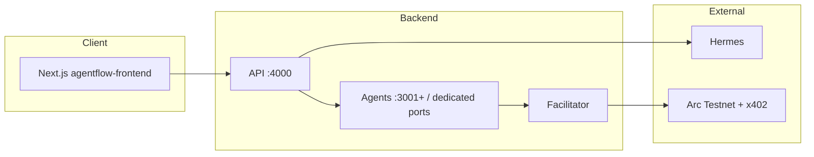

# AgentFlow

Private monorepo for the live AgentFlow dapp: Arc Testnet backend (`server.ts`, agents, x402) and the Next.js 14 UI in [`agentflow-frontend/`](agentflow-frontend/).

Demo **AI agent economy** on **Arc Testnet** — **Circle x402** micropayments, **Hermes** chat/orchestration, and **Circle developer-controlled wallets** + Gateway where configured.

This repo is the deploy source of truth. Backend and frontend ship together.

## Quick start

1. **Prerequisites:** Node **20+**, npm **8+**, `CLOUDSMITH_TOKEN` for `@circlefin/*` (see [.npmrc](.npmrc)).
2. **Install (repo root):** copy [.env.example](.env.example) → `.env`, then `npm run setup` (or load `CLOUDSMITH_TOKEN` and `npm install`).
3. **Frontend env:** copy `agentflow-frontend/.env.local.example` → `agentflow-frontend/.env.local` and set `NEXT_PUBLIC_BACKEND_URL=http://localhost:4000`.
4. **Full stack:** from the repo root:

   ```bash
   npm run dev:stack
   ```

   Starts the **API** (**:4000**), **Hermes** (**:8000** by default), **facilitator** (`FACILITATOR_PORT`, often **:3010**), dedicated **agents**, and the **Next.js** app on **:3005**.

   **Health:** `http://localhost:4000/health` · `http://localhost:3005/api/health` · Hermes `/health` on the Hermes port.

   **Windows:** if `:8000` is stuck (common with IP Helper), pin Hermes in `.env`:

   ```env
   AGENTFLOW_HERMES_PORT=8001
   AGENTFLOW_HERMES_URL=http://127.0.0.1:8001
   ```

   Then use `http://localhost:8001/health`. From the repo root, `npm run stack:detach` opens a PowerShell window that keeps `dev:stack` running.

   **Search:** set `SEARXNG_API_URL` in `.env` if you want SearXNG in addition to Firecrawl (not inferred from `FIRECRAWL_API_URL`).

5. **Frontend only (hot reload):** `npm run dev:frontend:hot` from root, or `cd agentflow-frontend && npm run dev`.

On **Windows PowerShell**, use `;` instead of `&&` if your shell rejects `&&`.

## Project structure

```text
agentflow/
├── server.ts                 # Public API gateway
├── agentflow-frontend/       # Next.js 14 app (chat, pay, portfolio, …)
├── agents/                   # x402 agent microservices
├── facilitator/              # x402 facilitator
├── hermes-skills/            # Hermes skill pack (used by Hermes, not Node boot)
├── lib/                      # Shared backend helpers
├── scripts/                  # setup, stack helpers, QA / smoke scripts
├── contracts/                # Solidity (Hardhat)
├── foundry/                  # Foundry layout (install forge libs locally)
├── crons/                    # Optional workers
├── docs/                     # Ops notes + historical audits
├── ecosystem.config.cjs      # PM2 process definitions (VPS)
├── package.json              # Root scripts (dev:stack, agents, …)
└── tsconfig.json             # Backend TypeScript project
```

Local-only (gitignored): `tmp/`, `.logs/`, `.agentflow-telemetry/`, Hermes checkout under `hermes-brain/`. Do not treat those as product source.

## Architecture (high level)



## Environment

See [.env.example](.env.example) for the full list. Commonly needed:

- **Wallet / chain:** `PRIVATE_KEY` or deployer keys as documented in `.env.example`
- **Registry:** `CLOUDSMITH_TOKEN`
- **Hermes:** `HERMES_API_KEY`, `HERMES_BASE_URL`, `HERMES_MODEL` (local stack also uses `AGENTFLOW_HERMES_PORT` / `AGENTFLOW_HERMES_URL`)
- **Execution safety:** `MAINNET_KILL_SWITCH=true` blocks money paths with 503. `EXECUTION_INFLIGHT_TTL_SEC` controls Redis `money:inflight:*` lock TTL.
- **Feature flags:** backend `AGENTFLOW_FEATURE_FUNDS`; frontend `NEXT_PUBLIC_FEATURE_FUNDS`
- **Supabase RLS:** service-role `adminDb` by default. Set `SUPABASE_RLS_USER_CLIENT=true` only after app JWTs work with PostgREST — see [docs/db-access-security.md](docs/db-access-security.md)
- **Circle DCW:** `CIRCLE_API_KEY`, `CIRCLE_ENTITY_SECRET`, optional `CIRCLE_WALLET_SET_ID` — `npm run script:setup-circle` can bootstrap some of this

## Running pieces separately

- **API only (agents external):** `npx cross-env EMBEDDED_AGENT_SERVERS=false tsx server.ts` (or `npm run start:api`)
- **Individual agents:** `npm run dev:swap`, `npm run dev:vault`, `npm run dev:bridge`, etc.
- **Stack cleanup (Windows):** `node scripts/stack-cleanup.cjs` frees ports before a clean restart

Prefer **`FACILITATOR_PORT=3010`** locally so facilitator does not clash with other tools on **:3000**.

## Production

- **Next.js:** `npm run build --prefix agentflow-frontend`, then serve on **:3005** (root `npm run dev:frontend` when a `.next` build exists).
- **VPS / PM2:** use [`ecosystem.config.cjs`](ecosystem.config.cjs) from the repo root on the server.
- **Notes:** [docs/railway-deploy.md](docs/railway-deploy.md), [docs/known-issues.md](docs/known-issues.md)

## Arc Testnet

- **USDC as gas** · **Chain ID:** `5042002` · **RPC:** `https://rpc.testnet.arc.network` · **Explorer:** https://testnet.arcscan.app

## Optional scripts

```bash
npm run dev:orchestrator -- "Research topic here"   # legacy three-agent research CLI
npm run proof:a2a                                   # A2A proof against a running stack
```

Skip stack startup for the proof: `PROOF_A2A_SKIP_STACK=1 npm run proof:a2a` (PowerShell: `$env:PROOF_A2A_SKIP_STACK="1"`).

## Notes

- **Gasless agent steps** use x402 batching; on-chain activity is mainly deposits/settlements as configured.
- **Stale Node processes** on `4000` / agent ports cause confusing failures — clean restart after changing `server.ts` or agents.
