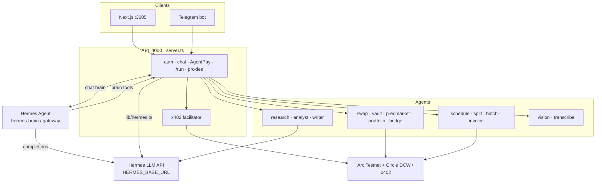
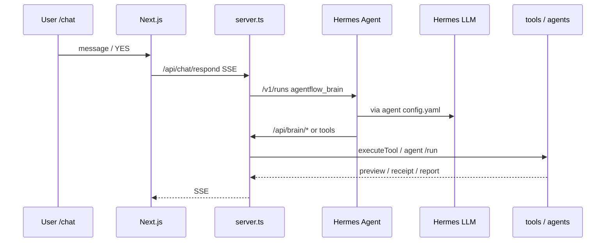
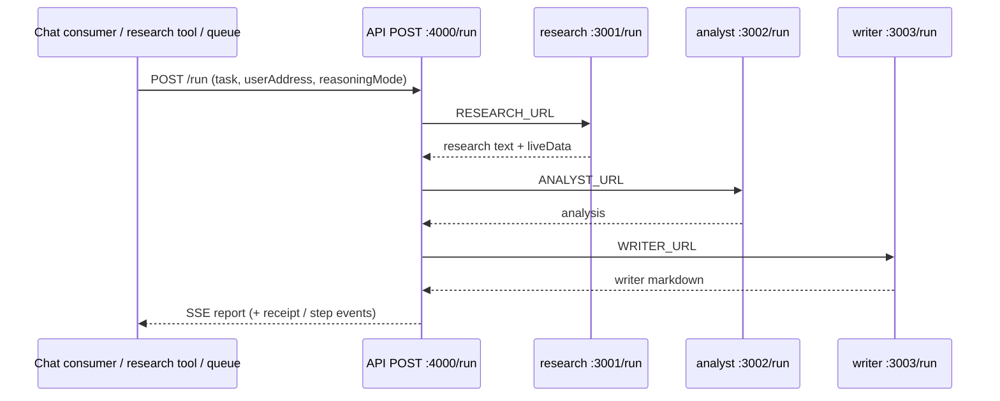
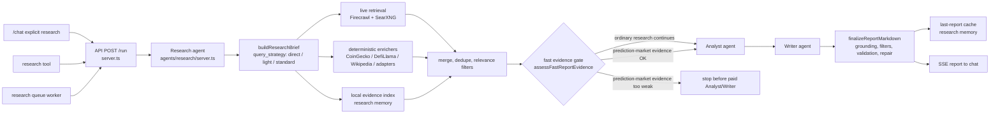

# AgentFlow

Private monorepo for the live **AgentFlow** product on **Arc Testnet**: Circle **x402** micropayments, chat-driven agents, AgentPay, and a **Next.js 15** UI (`agentflow-frontend/`, currently `15.5.20`).

Backend (`server.ts`, `agents/`, `facilitator/`) and frontend (`agentflow-frontend/`) ship together.

| | |
|--|--|
| **Private remote** | `pvt` → https://github.com/Snehal707/agentflow-pvt |
| **Production** | PM2 — [`ecosystem.config.cjs`](ecosystem.config.cjs) |
| **Local** | `npm run dev:stack` — `scripts/start-dev-stack.cjs` |

---

## Quick start (clone → local stack)

For judges / first clone. Needs **GitHub access** to the private repo, Node **20+**, npm **8+**, and Python with **Hermes Agent** available (`python -m gateway.run` — see [Hermes Agent install](https://hermes-agent.nousresearch.com/docs/getting-started/installation)).

```bash
git clone https://github.com/Snehal707/agentflow-pvt.git
cd agentflow-pvt

cp .env.example .env
# Required before install: CLOUDSMITH_TOKEN (Circle private npm — see .npmrc)
# Also set at least: HERMES_API_KEY, HERMES_BASE_URL, Circle DCW, Supabase/Redis, JWT/auth,
# FACILITATOR_PORT=3010 (dev:stack health-checks 3010), AGENTFLOW_BRAIN_INTERNAL_KEY
# Optional Windows if :8000 is stuck:
#   AGENTFLOW_HERMES_PORT=8001
#   AGENTFLOW_HERMES_URL=http://127.0.0.1:8001

npm run setup
# loads .env then root npm install only — does not install the frontend

npm install --prefix agentflow-frontend
cp agentflow-frontend/.env.local.example agentflow-frontend/.env.local
# set NEXT_PUBLIC_BACKEND_URL=http://localhost:4000
# set NEXT_PUBLIC_WALLETCONNECT_PROJECT_ID

# Hermes Agent: start-hermes prefers hermes-brain/.venv, else system python.
# hermes-brain/ is gitignored; start-hermes creates it and writes config.yaml + skills.

npm run dev:stack
```

**Check**

| URL | Expect |
|-----|--------|
| http://127.0.0.1:4000/health | API up |
| http://127.0.0.1:4000/health/stack | Subset healthy (facilitator, R/A/W, bridge, vision, transcribe) |
| http://127.0.0.1:3005 | UI |
| Hermes `/health` on `AGENTFLOW_HERMES_PORT` (default **8000**) | Agent gateway up |

**Use the app:** open http://localhost:3005 → connect wallet → sign JWT → enter a beta **access code** (from the operator / `access_codes` in Supabase — `AccessCodeGate`). Cron is **not** started by `dev:stack`.

Helpers: `npm run dev:stack:clean`, `npm run stack:detach`, `node scripts/stack-cleanup.cjs`. Full ports / PM2: §9.

---

## 1. Product surfaces

App nav (`agentflow-frontend/lib/appData.ts`): `/chat`, `/pay`, `/funding`, `/portfolio`, `/agents`, `/telegram`.

App shell (`app/(app)/layout.tsx`) wraps those in **`ClientProviders`** (dynamic `Providers`, `ssr: false`) plus **`AccessCodeGate`** and wallet JWT.

| Route | Role |
|-------|------|
| `/chat` | Main UX — JWT chat; money confirms with YES (`Yes, swap & send` when swap has a recipient — `ChatThread.tsx`) |
| `/pay` | AgentPay — `.arc` handles, send/request, contacts, schedule/split/batch, invoices, history |
| `/pay/[handle]` | Public pay page |
| `/funding` | Move Arc USDC **EOA ↔ DCW** (execution wallet) + faucet link — `funding/page.tsx` (UI copy: not a Gateway/bridge surface; `/vault` re-exports this page; `/funds` redirects here) |
| `/portfolio` | Holdings UI |
| `/agents` | Agent Store — catalog `lib/coreAgentSpecs.ts`; live prices `api/agent-store.ts` `resolveSystemAgentPrice()` (research = R+A+W sum; transcribe hardcoded `$0`) + reputation |
| `/telegram` | Link wallet to Telegram bot (bot deep links use `lib/app-urls.ts` → `/telegram`, not a `/settings` page) |
| `/docs` | Marketing docs (`GET /api/docs`) — marketing nav, not app sidebar |
| `/` | Marketing landing (`(marketing)/page.tsx`) — not an auto-redirect to `/chat` |
| `/internal/*` | Ops only (`memory`, `review`, `feedback`) — `INTERNAL_PANEL_KEY` + `INTERNAL_ADMIN_WALLETS` |

**Auth:** WalletConnect → nonce/sign JWT (`api/auth.ts`) → access-code claim (`api/access.ts`). Env: `AUTH_SIGN_DOMAIN`, `AUTH_NONCE_TTL_SECONDS`.

**Wallets:** EOA (auth + `/funding` source) · per-user **execution DCW** `user_agent` (spend / x402 buyer) · Circle **Gateway** (nanopay liquidity; funded from DCW via wallet APIs, not the `/funding` page UI today) — `api/wallet.ts`, `lib/dcw.ts`. Limits / `MAINNET_KILL_SWITCH`: `lib/execution-guard.ts`.

---

## 2. Architecture



**Local vs prod:** `dev:stack` sets `EMBEDDED_AGENT_SERVERS=false` (facilitator + R/A/W are separate processes). PM2 `agentflow-backend` embeds facilitator + research/analyst/writer. Cron is **PM2-only**.

### Chat → tools



Money paths: preview (`confirmed=false` / pending) → user **YES** → execute.

### Research reports

Verified in `server.ts` (chat research consumer ~L7252; `POST /run` orchestrator ~L15839+):

1. Chat research path (or `research` tool / queue worker) calls **`POST http://127.0.0.1:${PORT||4000}/run`**.
2. That handler calls agents in order via `RESEARCH_URL` → `ANALYST_URL` → `WRITER_URL` (defaults `127.0.0.1:3001|3002|3003/run`).
3. The **same** `/run` response streams SSE (`step_*`, `delta`, `receipt`, `report`). The chat handler reads that stream and forwards status/report to the browser.

Mode: `inferResearchReasoningMode` in `lib/researchMode.ts` (`fast` default; `deep` when explicit / phrase-matched). If the sync slot is full, chat **enqueues** first (`lib/research-queue.ts`) instead of calling `/run` immediately; the worker later calls the same `/run`.



#### Research source architecture

Source quality is layered. Do not debug final Sources by looking only at `finalizeReportMarkdown`; trace the whole path: live data -> research -> analyst -> writer -> finalizer -> chat `/run` consumer.



Current behavior on `pvt/main`:

- Explicit research/report prompts bypass Hermes Agent and enter `/run`; this prevents the chat brain from inventing citations.
- Live retrieval is Firecrawl + SearXNG plus deterministic enrichers and task-specific adapters. Local research memory / evidence-index paths can supplement weak live retrieval.
- Ordinary fast research does **not** abort just because the first live retrieval pass has fewer than two source domains; Analyst/Writer/finalizer continue and the report must caveat sparse evidence.
- Prediction-market research keeps stricter pre-Analyst evidence gates because bad sources can produce a wrong market decision. Sports winner topics need fresh, source-backed event-stage or result evidence; numerical rankings are optional and are allowed only when visible source evidence supplies the odds/probabilities. Price/market-cap markets still need numeric market snapshots and independent context.
- Final Sources are rebuilt from grounded live/research evidence, not copied blindly from writer markdown. The finalizer filters low-value/circular/tooling sources, validates dates/domains, repairs where possible, and may omit unsupported citations.
- Timeout/retry protection prevents Firecrawl or x402 retry storms from blocking the stack; failed retrieval paths should degrade through the remaining layers instead of spinning forever.

Inside the research agent (before analyst/writer):

- **fast / deep modes** still apply at the research agent (`agents/research/server.ts` / `deepPipeline`) after `/run` passes `reasoningMode`.
- Retrieval planning on this path is **Node code**: `agents/research/orchestrator.ts` — `buildResearchBrief` via `callHermesFast` with `query_strategy`: `direct` | `light` | `standard` (does not load the skill file).
- Explicit research/report (and some related) asks in web chat **bypass Hermes Agent** and go straight to this `/run` pipeline (`server.ts` `shouldHandleAsResearchRequest` / research fast-path) so Agent cannot invent citations.
- Hermes Agent skill for the same vocabulary: [`hermes-skills/agentflow-report-research`](hermes-skills/agentflow-report-research/SKILL.md) — installed into `hermes-brain/skills/` and reachable via `skills_list` / `skill_view` when Agent is in the loop (see §5; smoke: `npm run smoke:hermes-research-skill`). Not a required step on every report.

Persist/search helpers: `lib/research-memory.ts`.

---

## 3. Hermes Agent vs Hermes LLM

Same brand, **different layers** — not two peer “clients.”

| | **Hermes Agent** | **Hermes LLM** |
|--|------------------|----------------|
| **What** | Agent runtime ([hermes-agent](https://github.com/nousresearch/hermes-agent)) | Model API (e.g. Hermes-4) |
| **Here** | `hermes-brain/` · `scripts/start-hermes.cjs` · PM2 `agentflow-hermes` | `HERMES_BASE_URL` (default `inference-api.nousresearch.com/v1`) |
| **Entry** | `lib/agent-brain.ts` → `AGENTFLOW_HERMES_URL` `/v1/runs` | Agent `config.yaml` **and** Node `lib/hermes.ts` |
| **Env** | `AGENTFLOW_HERMES_*`, API server key | `HERMES_API_KEY`, `HERMES_BASE_URL`, `HERMES_MODEL*` |

**Agent uses the LLM.** Chat brain goes through the Agent. Most other paths call the LLM **directly** via `lib/hermes.ts`.

| Uses **Agent** (`/v1/runs`) | Uses **LLM only** (`lib/hermes.ts`) |
|----------------------------|-------------------------------------|
| Default web `/chat` conversation (`runAgentBrain`) — except research-routed asks (`shouldHandleAsResearchRequest`), which bypass Agent → `/run` | Research / analyst / writer (+ embedded handlers in `server.ts`) |
| Fast-report **review** (`lib/fast-report-supervisor.ts`, if Agent URL set) | Fast-report **rewrite**; report follow-ups; profile extract; translate |
| Chat QA scripts | Telegram chat + intent (no Agent); schedule NL; portfolio narrative; invoice PDF; vision/PDF helpers; market understanding; intent router if enabled |

Config/soul: `start-hermes.cjs` writes `hermes-brain/config.yaml` + `SOUL.md`. Skills: see §5 (Hermes Agent skill pack vs Node `/run` planning).

---

## 4. Tools

Schemas: `lib/agentflow-tools.ts` → `lib/tool-executor.ts`.

| Tool | Purpose |
|------|---------|
| `get_balance` | USDC, EURC, vault balance |
| `swap_tokens` | USDC ↔ EURC; preview then YES |
| `vault_action` | list / position / deposit / withdraw (`luneUSDC`, `luneEURC`) |
| `predict_action` | Pred-market list / detail / buy / sell / redeem / refund |
| `agentpay_send` / `agentpay_request` | Send preview → YES · payment request |
| `bridge_precheck` | Supported CCTP sources + flow |
| `get_portfolio` | Holdings / PnL |
| `research` | Topic research (`fast` \| `deep`) |

Brain HTTP (Hermes Agent → API): `GET/POST /api/brain/{balance,portfolio,circle-stack,agentpay-history,swap,vault,bridge,bridge-precheck}`.

UI may show aliases (`agentflow_swap`, …) in `lib/agent-brain.ts` — not a second public API. Schedule/split/batch/invoice are Agent Store + `/pay` surfaces; not all are in `AGENTFLOW_TOOLS`.

---

## 5. Skills

Two different consumers — do not collapse them:

| Path | What it is | Who uses it |
|------|------------|-------------|
| [`hermes-skills/agentflow-report-research/SKILL.md`](hermes-skills/agentflow-report-research/SKILL.md) | Hermes **Agent** skill: `direct` / `light` / `standard` report retrieval guidance (`skill_view` / `skills_list`) | Available to Hermes Agent chat; **not** a formal step on default `/run` reports (those use `orchestrator.ts`) |
| [`agentflow-frontend/SKILL.md`](agentflow-frontend/SKILL.md) | Intent / anti-hallucination rules for payments & balances | Optional Hermes Agent install (see that file); not auto-copied by `start-hermes` today |

**How AgentFlow wires the research skill (verified):**

1. `scripts/start-hermes.cjs` sets `HERMES_HOME` → `hermes-brain/`
2. On each start it **copies** every `hermes-skills/*/SKILL.md` pack into `hermes-brain/skills/` (real files, not a junction — junctions warn as “outside trusted skills dir”)
3. Hermes config `platform_toolsets.api_server` includes **`agentflow_brain` + `skills`**
4. Chat brain (`lib/agent-brain.ts`) enables the same: `enabled_toolsets: ['agentflow_brain', 'skills']`
5. `start-hermes.cjs` writes Hermes `config.yaml` `system_prompt` telling the Agent to `skill_view` **`agentflow-report-research`** when planning research-report retrieval (not in `lib/agent-brain.ts` prompts)

**Smoke (local Hermes up):**

```bash
npm run smoke:hermes-research-skill
```

Verified: Hermes `/v1/runs` + `skills_list` returned `agentflow-report-research`.

**Node research `/run`:** plans via `orchestrator.ts` → Hermes **LLM** (`lib/hermes.ts`) with the same `direct` / `light` / `standard` vocabulary in code. Explicit research/report chat requests bypass Hermes Agent and hit this pipeline.

---

## 6. Agent Store & DeFi providers

**Catalog** — metadata in `lib/coreAgentSpecs.ts`. **Store/UI prices** from `api/agent-store.ts` `resolveSystemAgentPrice()` (not raw `*_AGENT_PRICE` alone):

| Slug | Notes |
|------|--------|
| `research` | Research → Analyst → Writer; store price = sum of `RESEARCH` + `ANALYST` + `WRITER` agent prices |
| `swap` | Arc swaps (multi-DEX router) |
| `vault` | Lunex (`luneUSDC` / `luneEURC`) |
| `predmarket` | AchMarket |
| `bridge` | CCTP into Arc |
| `portfolio` | Balances / PnL |
| `invoice` | Chat invoices → AgentPay **To Pay** (not the legacy email-inbox business flow) |
| `schedule` / `split` / `batch` | Recurring / split / CSV USDC |
| `vision` | x402-paid; Hermes + OpenAI fallback |
| `transcribe` | OpenAI voice→text; free (`resolveSystemAgentPrice` hardcodes `0`); JWT + daily caps; no x402 middleware |

**Providers (code):**

| Area | Implementation |
|------|----------------|
| Swap | `lib/dex/router.ts` — **swaparc**, **achswap**, **lunex** |
| Vault | `lib/vault/router.ts` — Lunex only |
| Pred markets | `lib/predmarket/router.ts` — AchMarket only |
| Bridge | CCTP; sources in `lib/bridge/supportedSources.ts` |
| AgentPay tokens | USDC + EURC — `lib/agentpay-transfer.ts` |

**x402 facilitator:** Circle Gateway batched proxy (`facilitator/server.ts` — `/v1/x402/supported|verify|settle`). Separate process in `dev:stack`; **embedded in PM2 backend**. Prefer `FACILITATOR_PORT=3010` (code default **3000** if unset).

---

## 7. Reputation & agent economy

Wired into Agent Store + paid tasks (not a nav item).

| Piece | Where |
|-------|--------|
| ERC-8004 reputation | `lib/reputation.ts` · `ARC.reputationRegistry` |
| Star ratings | `POST /api/agent-ratings` → `api/agent-ratings.ts` (stars × 20) |
| Ratings table | `db/migrations/20260515_create_agent_ratings.sql` |
| Store UI | `/agents` — `reputationScore` |
| Docs/RAG copy | `docsContent.ts`, `lib/product-rag.ts` |
| A2A ledger | `lib/a2a-ledger.ts` → `lib/agent-economy-ledger.ts` · `GET /api/agent-economy-ledger` |
| A2A follow-ups | `lib/a2a-chat-scheduler.ts`, `lib/a2a-followups.ts` |
| Identity mint | `lib/mintIdentityOwners.ts` · `ARC.identityRegistry` (validation registry address configured; little other runtime use) |
| `.arc` registry | `contracts/AgentPayRegistry.sol`, `lib/agentpay-registry.ts`, `AGENTPAY_REGISTRY_ADDRESS` |
| x402 attempts | `lib/x402AttemptLedger.ts` |

Vision/transcribe may call `recordReputationSafe` after runs. **Counterparty “reputation” in chat** (`.arc` risk) uses internal cache + payment history — not ERC-8004 store ratings.

---

## 8. Production cron

`crons/index.ts` runs only when `NODE_ENV=production` (PM2 `agentflow-cron`). **Do not treat every scheduled callback as a product feature** — several jobs no-op, throw without env, or write nowhere users see.

**Tied to current product (code + surface):**

| Job | UTC | Why it counts |
|-----|-----|----------------|
| Due scheduled USDC payments (`processDuePayments`) | 09:00 (with daily tick) | AgentPay schedules (`/pay`, schedule agent) |
| Agent treasury top-up (`runTreasuryTopUp`) | hourly | Platform USDC into **agent `owner` wallets** (A2A liquidity) — not user Gateway/Funding |
| Semantic-memory consolidation | every 6h at :15 | Chat memory (`lib/semantic-memory.ts`; admin/internal panels) |

**Still scheduled in `crons/index.ts`, but not current product docs material without proof they ship value:**

| Job | UTC | Evidence |
|-----|-----|----------|
| Daily topic briefs + weekly `arc_ecosystem` | 09:00 / Mon 09:00 | `generateDailyReport` only fills an **in-memory** `Map` in `lib/daily-report.ts` — nothing else reads it; lost on process restart |
| Yield monitor | every 6h | Skips without vault config; only users with `yield_monitoring=true` |
| Training export | 03:00 | Needs `TRAINING_EXPORT_BUCKET` + `TRAINING_EXPORT_SALT` (not in `.env.example`); throws if unset |

**Legacy (not current product — code may still exist, do not build on it):**

| Piece | Status |
|-------|--------|
| Current invoices | Chat → confirm → AgentPay **Invoices → To Pay**. Any signed-in wallet can create; recipient pays/declines. |
| `businesses` table / `/api/business/*` | Old B2B profile + settlement rules. Not required for chat invoices. |
| Email inbound (`/api/webhooks/email`) | Old “email PDF to `@invoices.agentflow.one`” path. |
| Monthly business digest | **Disabled** in `crons/index.ts` (was 1st 09:00 Telegram/Resend PDF). |

Local `dev:stack`: **no cron**. Chat capture/retrieval: `lib/semantic-memory.ts`. Local dirs `.agentflow-memory/`, `.agentflow-telemetry/` are gitignored.

---

## 9. Runbook

See **Quick start** above for clone → first local run. This section is the expanded operator reference.

### Prerequisites

- Node **20+**, npm **8+**, `CLOUDSMITH_TOKEN` ([.npmrc](.npmrc))
- `.env` ← [.env.example](.env.example); `npm run setup` (root install only)
- `npm install --prefix agentflow-frontend`
- `agentflow-frontend/.env.local` ← `.env.local.example` (`NEXT_PUBLIC_BACKEND_URL`, WalletConnect; optional Telegram username; `OPENAI_API_KEY` for transcribe)
- Hermes Agent on PATH or in `hermes-brain/.venv` (`python -m gateway.run`); `start-hermes.cjs` creates gitignored `hermes-brain/` + config

### Local

```bash
npm run dev:stack
```

Frontend `:3005`, Hermes Agent, facilitator, R/A/W, API `:4000`, DeFi/payment/media agents, Telegram bot. **No cron.**

| Check | Notes |
|-------|--------|
| `:4000/health` | Liveness |
| `:4000/health/stack` | **Subset only:** facilitator, research, analyst, writer, bridge, vision, transcribe — **not** swap/vault/predmarket/portfolio/invoice/schedule/split/batch |
| `:3005/api/health` | Frontend |
| Hermes `/health` | `AGENTFLOW_HERMES_PORT` (default 8000) |

Windows `:8000` stuck → set `AGENTFLOW_HERMES_PORT=8001` + `AGENTFLOW_HERMES_URL` (see `.env.example`). Helpers: `stack:detach`, `dev:stack:clean`, `node scripts/stack-cleanup.cjs`.

### Production (PM2)

```bash
npm install
npm run build --prefix agentflow-frontend
pm2 start ecosystem.config.cjs    # first time
pm2 reload all                    # after deploy
pm2 save && pm2 startup
```

Apps: hermes, backend (API + embedded facilitator/R/A/W), swap, vault, portfolio, vision, transcribe, bridge, invoice, split, batch, schedule, predmarket, cron, telegram-bot, frontend (`next start -p 3005`).

### Ports

| Service | Port |
|---------|------|
| Frontend | 3005 |
| API | 4000 |
| Hermes Agent | 8000 (`AGENTFLOW_HERMES_PORT`) |
| Facilitator | Prefer **3010** (`FACILITATOR_PORT`; code unset → **3000**). `dev:stack` health-checks **3010** — set that in `.env` or the supervisor will miss it |
| Research / Analyst / Writer | 3001 / 3002 / 3003 |
| Swap / Vault / Predmarket / Portfolio | 3011 / 3012 / 3013 / 3014 |
| Invoice / Vision / Transcribe | 3015 / 3016 / 3017 |
| Schedule / Split / Batch / Bridge | 3018 / 3019 / 3020 / 3021 |

### Environment (summary)

Full list: [.env.example](.env.example). Typically: Cloudsmith, `HERMES_*`, Hermes Agent URL/port + brain key, Circle DCW, JWT/auth, Redis/Supabase, facilitator/agent ports, Telegram, WalletConnect, `AGENTPAY_REGISTRY_ADDRESS`, research keys as needed.

Optional safety: `MAINNET_KILL_SWITCH`, `PAY_PER_TASK_*`, `VISION_DAILY_LIMIT`, `TRANSCRIBE_DAILY_LIMIT`.

More: [docs/db-access-security.md](docs/db-access-security.md) · [docs/known-issues.md](docs/known-issues.md)

---

## 10. Reference

### Operator scripts (`package.json`)

| Script | Purpose |
|--------|---------|
| `setup` | First-time install |
| `dev:stack` / `dev:stack:clean` / `stack:detach` | Full local stack |
| `dev:hermes` / `dev:chat-core` | Hermes / minimal chat |
| `start:api` | API only (`EMBEDDED_AGENT_SERVERS=false`) |
| `qa:prelaunch` (+ chat/agents variants) | Pre-launch QA |
| `cron:worker` | Cron (needs `NODE_ENV=production`) |
| `treasury:topup` | One-shot treasury |
| `memory:consolidate` / `memory:metrics` / `memory:eval` | Semantic memory |
| `script:pre-launch` / `script:check-balances` | Checks |
| `script:setup-circle` / `script:mint-identity` / `script:create-missing-wallets` | Bootstrap |
| `deposit:agent-gateway` / `fund:agent-wallets` | Funding |
| `contract:deploy-agentpay-registry` | Deploy `.arc` registry |
| `typecheck` | `tsc --noEmit` |
| `dev:swap`, `dev:vault`, … | Single agents |

### API mounts (`server.ts`)

| Mount | Role |
|-------|------|
| `/api/auth`, `/api/access` | JWT + access code |
| `/api/wallet`, `/api/telegram`, `/api/settings` | Wallet / Telegram link APIs (`/api/settings/telegram/*` is a legacy alias; **no** `/settings` UI page — use `/telegram`) |
| `/api/agentpay`, `/api/business`, `/api/pay` | AgentPay / business / pay + `.arc` |
| `/api/agent-store`, `/api/agent-ratings`, `/api/agent-economy-ledger` | Store / ratings / A2A ledger |
| `/api/portfolio`, `/api/docs`, `/api/stats` | Portfolio / docs / stats |
| `/api/chat/respond`, `/api/chat/feedback` | Chat |
| `/api/research/status/:jobId`, `/api/research/queue` | Research jobs |
| `/api/x402/preflight`, `/api/x402/attempts/*` | x402 |
| `/api/brain/*` | Hermes Agent tools |
| `/api/schedule|split|batch|invoice/*` | Payment confirms |
| `/api/bridge/finalize`, `/api/media/quota`, `/api/dcw/agents/:slug/run` | Bridge / media / DCW run |
| `/api/profile/remember` | Profile facts |
| `/api/memory/*`, `/api/internal/*` | Admin |
| `POST /run` | Research pipeline |
| `/health`, `/health/stack` | Liveness (stack = subset) |

Retired but still mounted: `/api/extension`, `/api/webhooks/email`.

### Debug flags (`.env.example`)

`AGENTFLOW_X402_DEBUG`, `AGENTFLOW_CIRCLE_DEBUG`, `AGENTFLOW_A2A_DEBUG`, `AGENTFLOW_CHAT_SESSION_TRACE`, `AGENTFLOW_CHAT_SSE_DEBUG`, `FAST_REPORT_SUPERVISOR_ENABLED`, `INTENT_ROUTER_ENABLED` (default false).

### Repo layout

```text
server.ts                 API (+ prod embedded facilitator/R/A/W)
agentflow-frontend/       Next.js UI
agents/                   Microservices
facilitator/              x402 facilitator
api/                      Express routers
lib/                      Shared backend
hermes-skills/            Hermes Agent skill pack (copied into hermes-brain/skills/ by start-hermes)
crons/                    PM2 cron
scripts/                  Stack / Hermes launchers
ecosystem.config.cjs      PM2
docs/                     Ops notes
contracts/ · foundry/     On-chain tooling
```

Gitignored: `hermes-brain/`, `tmp/`, `.logs/`, `.agentflow-telemetry/`, `.agentflow-memory/`.

---

## Arc Testnet

Chain ID `5042002` · RPC `https://rpc.testnet.arc.network` · Explorer https://testnet.arcscan.app · USDC as gas

---

## Out of scope

`/dashboard`, `orchestrator/` / `dev:orchestrator`, Railway writeups, one-off probes, retired **extension** + **email inbound** webhook (still mounted under `api/` — not product). Prefer this README + cited sources + `ecosystem.config.cjs`.
